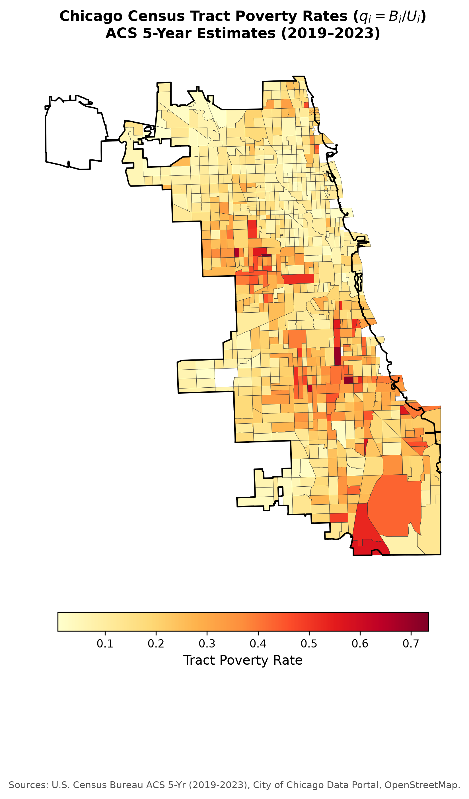
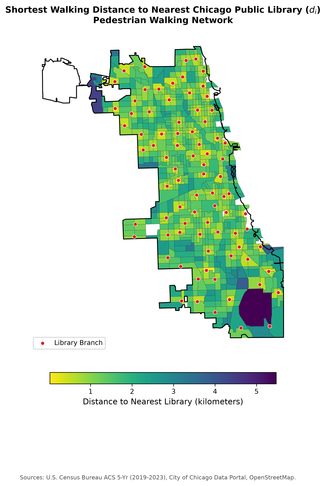
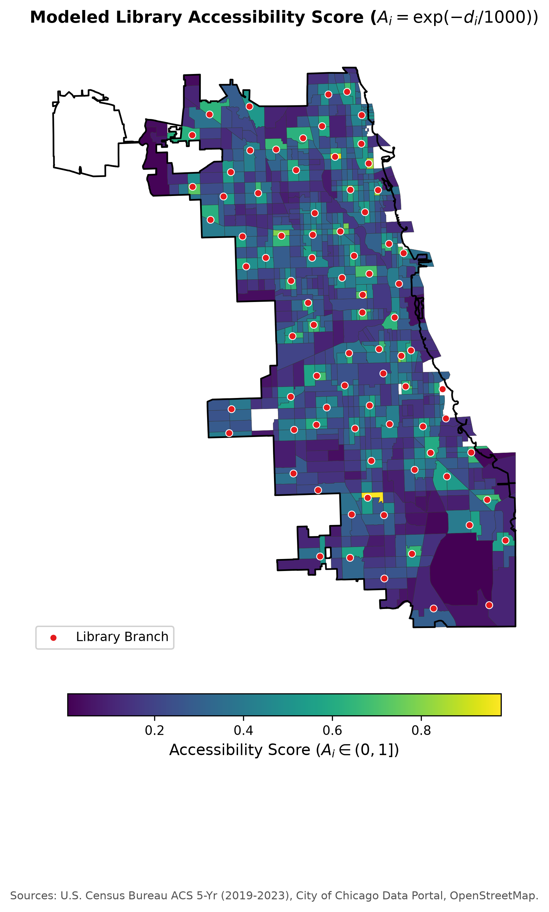
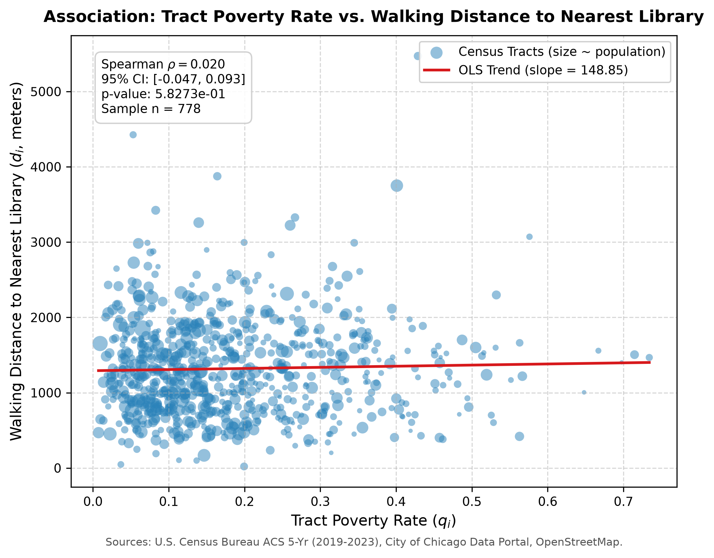
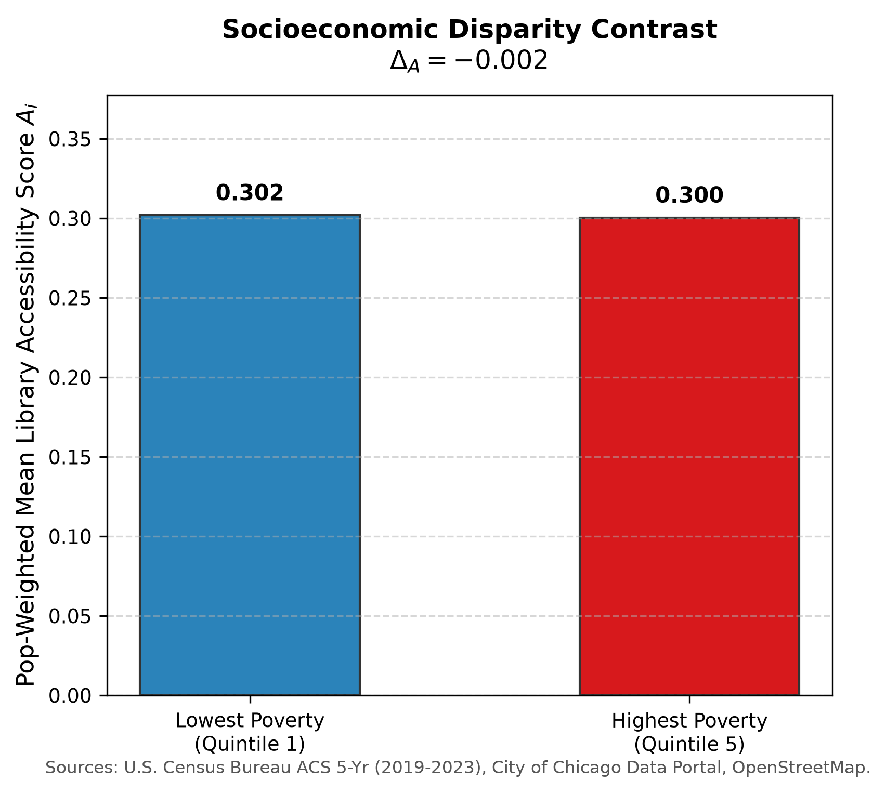
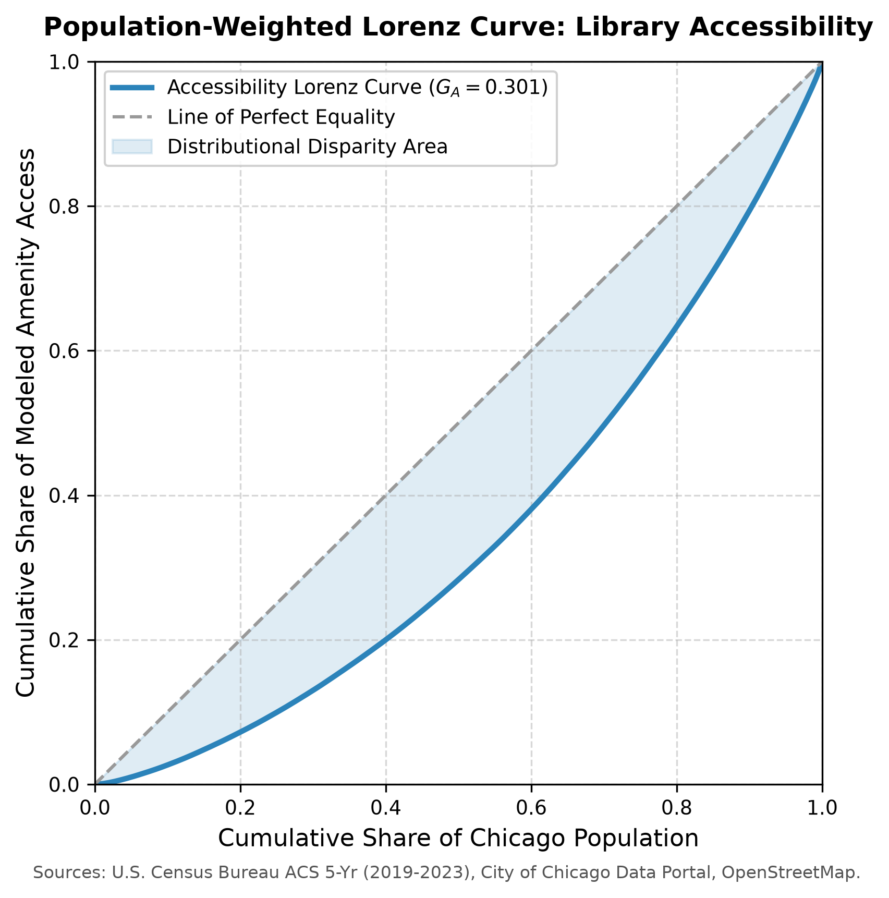
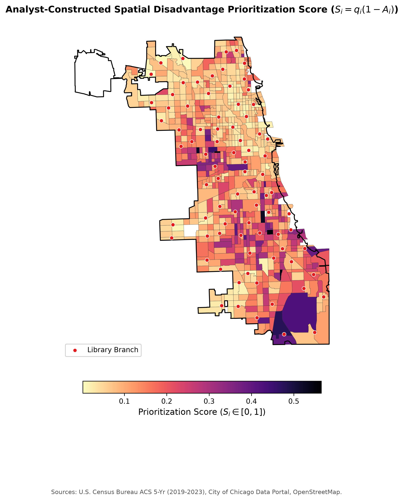
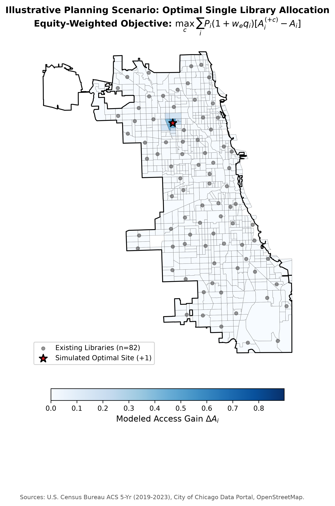

# Quantifying Spatial (In)Justice With Mathematics, Open Data, and Python

[](https://github.com/monourhosan/spatial-justice-lab/actions)
[](https://opensource.org/licenses/MIT)
[](https://www.python.org/downloads/)
[](https://github.com/astral-sh/ruff)

An applied mathematical, computational, and open-data research repository operationalizing and empirically testing socioeconomic spatial accessibility disparities to public amenities across Chicago census tracts.

---

## Nontechnical Abstract (185 words)

How does social disadvantage manifest in physical urban space? This research project develops a rigorous mathematical and computational framework to empirically test an important proposition inspired by urban spatial justice theory: whether neighborhoods with greater socioeconomic disadvantage experience systematically poorer walking access to essential public amenities. Focusing on the City of Chicago, Illinois, the study integrates aggregate tract-level socioeconomic estimates from the U.S. Census Bureau American Community Survey (ACS 2019–2023 5-Year Estimates) with verified public library branch locations from the City of Chicago Open Data Portal and an 88,549-node walkable street network. 

Analyzing 778 populated census tracts encompassing 2.66 million residents and 82 library branches, we compute shortest pedestrian network distances, bounded exponential accessibility scores, population-weighted Gini coefficients, and heteroskedasticity-robust econometric regressions. The empirical findings reveal a near-zero, statistically non-significant association between tract poverty rate and walking distance ($\rho = +0.020, p = 0.583$), with virtually identical accessibility across the highest- and lowest-poverty quintiles ($\Delta_A = -0.0015$). Instead, urban population density is the overwhelming determinant of proximity ($\beta = -0.242, p < 10^{-16}$). This highlights successful physical branch dispersal while underscoring that contemporary spatial justice challenges center on facility quality, hours, and operational equity rather than physical distance alone.

---

> [!IMPORTANT]
> **Critical Scientific Distinction:**  
> This project is an **empirical test of one operationalized, falsifiable proposition** within a single municipality. It is **not a mathematical proof or refutation of broad theories of spatial justice**. A mathematical derivation establishes properties of an index conditional on its declared definitions; observational data can support, complicate, or fail to support a specific hypothesis. Correlation does not imply causation, and physical spatial proximity is not equivalent to substantive social justice.

---

## 1. Intellectual Starting Point and Conceptual Citation

The conceptual motivation for this research is derived from the edited volume:

> **Adnan Zillur Morshed (ed.), *Spatial (In)Justice: How Does It Manifest in the Built Environment?*, John Wiley & Sons, 2024.**  
> *ISBN-13:* 978-1394294664 (Print) / 978-1394294671 (eTextbook)

Based on its published scholarly overview, the volume brings together architects, urban planners, and theorists to examine how the built environment organizes power, privilege, inclusion, and opportunity, emphasizing marginalized communities and the ethical responsibilities of designers. This study operationalizes one falsifiable proposition inspired by this discourse:

> *Tested Proposition:* Neighborhoods with greater socioeconomic disadvantage have poorer spatial access to selected public amenities, even when those amenities are essential for equitable urban life.

---

## 2. Research Questions and Preregistered Hypotheses

### Primary Research Question
**Are higher-poverty census tracts in Chicago associated with longer walking-network distances to public libraries and/or lower modeled access to selected public amenities?**

### Preregistered Hypotheses
- **$H_0$ (Null Association):** There is no monotonic tract-level association between poverty rate and nearest-library walking distance ($\rho = 0$).
- **$H_{1a}$ (Directional Distance Disparity):** Higher-poverty tracts tend to have systematically longer walking-network distances to public libraries ($\rho > 0$).
- **$H_{1b}$ (Directional Access Disparity):** Higher-poverty tracts tend to have lower modeled accessibility scores ($\rho(q, A) < 0$).
- **$H_2$ (Quintile Disparity Contrast):** The population-weighted mean accessibility in the highest-poverty quintile is strictly lower than in the lowest-poverty quintile ($\Delta_A < 0$).

---

## 3. Mathematical Model Summary

Complete derivations, proofs of bounds, and monotonicity theorems are provided in [`docs/mathematical_model.md`](docs/mathematical_model.md) and [`docs/derivations.md`](docs/derivations.md).

### 3.1 Tract Poverty Rate
$$
q_i = \frac{B_i}{U_i}, \qquad U_i > 0, \quad 0 \le q_i \le 1,
$$
where $B_i$ is the ACS count of persons below the poverty threshold and $U_i$ is the poverty status determination universe (`B17001_001E`).

### 3.2 Shortest Walking-Network Distance
$$
d_i = \min_{j \in \mathcal{L}} d_G(o_i, f_j),
$$
computed via multi-source reverse Dijkstra search on the planarized pedestrian network $G = (V, E)$, measuring distance in meters from tract representative origin point $o_i$ to library facility $f_j$.

### 3.3 Bounded Exponential Accessibility Score
$$
A_i(\tau) = \exp\left(-\frac{d_i}{\tau}\right), \qquad \tau > 0, \quad 0 < A_i \le 1,
$$
where $\tau = 1,000 \text{ m}$ is the declared analytical scale parameter, with sensitivity checks at $\tau = 500 \text{ m}$ and $\tau = 2,000 \text{ m}$.

### 3.4 Population-Weighted Gini Coefficient
$$
G_A = \frac{\sum_{i=1}^n \sum_{k=1}^n P_i P_k |A_i - A_k|}{2 P^2 \bar{A}_P}, \qquad \bar{A}_P = \frac{1}{P}\sum_{i=1}^n P_i A_i.
$$

### 3.5 Poverty-Gradient Quintile Disparity
$$
\Delta_A = \frac{\sum_{i \in H} P_i A_i}{\sum_{i \in H} P_i} - \frac{\sum_{i \in L} P_i A_i}{\sum_{i \in L} P_i},
$$
where $H$ and $L$ denote the top and bottom tract poverty rate quintiles.

### 3.6 Associational Econometric Regression
$$
\log(1 + d_i) = \beta_0 + \beta_1 q_i + \beta_2 \log(1 + \text{density}_i) + \beta_3 \log(\text{income}_i) + \epsilon_i,
$$
estimated with White / HC1 heteroskedasticity-consistent standard errors.

---

## 4. Empirical Findings on Chicago

All metrics below are computed from official datasets executed through the pipeline:

| Analytical Parameter | Computed Value | Scientific Interpretation |
|---|---|---|
| **Analysis Tracts ($n$)** | 778 populated tracts | 100% of populated municipal tracts with valid ACS data |
| **Analyzed Residents ($P$)** | 2,664,576 persons | Total population covered in study |
| **Library Facilities ($m$)** | 82 branches | Complete official Chicago Public Library system |
| **Walking Distance ($d_i$) Median** | 1,242.8 m (1.24 km) | Typical resident is within a ~15-minute walk |
| **Walking Distance ($d_i$) Mean** | 1,319.5 m (1.32 km) | Standard deviation: 632.2 m |
| **Walking Distance ($d_i$) Range** | 20.6 m to 5,470.9 m | Max distance in peripheral industrial/O'Hare border |
| **Mean Access Score ($\bar{A}_P$, $\tau=1000$)** | 0.315 | Bounded in $(0, 1]$ |
| **Inequality Gini ($G_A$, $\tau=1000$)** | 0.301 | Moderate inequality in spatial proximity |
| **Spearman Rank Correlation ($\rho$)** | **+0.020** ($p = 0.583$) | **Fail to reject $H_0$**; 95% Bootstrap CI: $[-0.047, 0.093]$ |
| **Pearson Correlation ($r$)** | +0.030 ($p = 0.405$) | Confirms absence of linear association |
| **Quintile Disparity ($\Delta_A$)** | **-0.0015** | Q1 (Low Poverty): 0.302 vs. Q5 (High Poverty): 0.300 |
| **Regression Poverty Coeff ($\beta_1$)** | -0.081 ($p = 0.754$) | Statistically non-significant with HC1 standard errors |
| **Regression Density Coeff ($\beta_2$)** | **-0.242** ($p < 10^{-16}$) | Urban density strongly drives shorter walking distance |
| **Residual Spatial Autocorr (Moran $I$)** | 0.261 ($z = 12.11, p = 0.001$) | Significant spatial clustering across neighborhoods |
| **MOE Sampling Sensitivity** | $\rho \in [-0.047, 0.093]$ | Stable under 100 Monte Carlo ACS MOE draws |

*Full results report available at [`results/findings.md`](results/findings.md) and machine-readable data at [`results/metrics.json`](results/metrics.json).*

---

## 5. Visualizations

| Figure Preview | Description |
|---|---|
|  | **Fig 1:** Spatial distribution of tract poverty rates ($q_i$) from ACS 2019–2023 5-Year Estimates. |
|  | **Fig 2:** Shortest walking network distance ($d_i$, km) to nearest library branch overlay. |
|  | **Fig 3:** Exponential accessibility score ($A_i = \exp(-d_i / 1000)$). |
|  | **Fig 4:** Scatterplot of poverty rate vs. walking distance with OLS fit and 95% bootstrap CI ($\rho = +0.020$). |
|  | **Fig 5:** High vs. low poverty quintile accessibility contrast ($\Delta_A = -0.0015$). |
|  | **Fig 6:** Population-weighted Lorenz curve for library accessibility ($G_A = 0.301$). |
|  | **Fig 7:** Prioritization index combining poverty and distance gaps ($S_i = q_i (1 - A_i)$). |
|  | **Fig 8:** Illustrative optimal placement simulation for one additional library branch. |

*Interactive Web Map:* An interactive map with choropleth shading and library markers is saved at [`results/interactive_chicago_map.html`](results/interactive_chicago_map.html).

---

## 6. Repository Architecture

```text
spatial-justice-mathematical-model/
├── README.md                           # Master project overview, abstract, and findings
├── LICENSE                             # MIT Open Source License
├── CITATION.cff                        # Machine-readable scholarly citation record
├── .gitignore                          # Excludes credentials, caches, and raw bulk binaries
├── .env.example                        # Template for optional Census API credentials
├── pyproject.toml                      # Modern Python packaging configuration
├── requirements.txt                    # Pinned dependency manifest
├── configs/
│   └── chicago.yaml                    # Declarative experiment parameters and URLs
├── data/
│   ├── README.md                       # Data directory rules and provenance
│   ├── metadata/
│   │   └── datasets.yml                # Machine-readable dataset catalog and licenses
│   ├── raw/                            # Gitignored raw government downloads & GraphML
│   ├── processed/                      # Cleaned GeoDataFrames (GeoPackage)
│   └── sample/                         # Synthetic test fixtures
├── src/
│   └── spatial_justice/
│       ├── __init__.py                 # Package exports and version metadata
│       ├── pipeline.py                 # CLI orchestration entry point
│       ├── acquisition.py              # Robust HTTP downloaders with caching
│       ├── cleaning.py                 # Demographic sentinels and coordinate validators
│       ├── geography.py                # Projected CRS transformations and boundary containment
│       ├── routing.py                  # Multi-source Dijkstra network shortest paths
│       ├── mathematics.py              # Formal formulas (A_i, G_A, Delta_A, S_i, simulation)
│       ├── statistics.py               # Spearman bootstrap, OLS HC1, Moran's I, MOE sensitivity
│       ├── visualization.py            # Static publication figures and Folium web map
│       └── reporting.py                # Automated findings.md and metrics.json generation
├── tests/
│   ├── test_mathematics.py             # Math formula tests (bounds, monotonicity, Gini)
│   ├── test_routing.py                 # Known-distance synthetic graph routing tests
│   ├── test_data_validation.py         # Schema parsing and sentinel value tests
│   └── test_pipeline_smoke.py          # End-to-end synthetic pipeline test
├── docs/
│   ├── mathematical_model.md           # Formal equation derivations and variable dictionary
│   ├── derivations.md                  # Proofs of bounds, limits, and mathematical scope
│   ├── research_design.md              # Research question, study design, and hypotheses
│   ├── data_sources.md                 # Dataset catalog, URLs, schemas, and limitations
│   ├── methodology.md                  # Technical walkthrough of algorithms and estimation
│   ├── reproducibility.md              # Step-by-step reproduction instructions
│   ├── limitations_and_ethics.md       # Ecological fallacy, MAUP, and ethical guidelines
│   └── github_publish_steps.md         # Instructions for publishing repository to GitHub
├── results/
│   ├── README.md                       # Deliverable directory manifest
│   ├── findings.md                     # Scientific research findings report
│   ├── metrics.json                    # Full structured numeric parameters and run metadata
│   ├── interactive_chicago_map.html    # Interactive Leaflet web map
│   ├── tables/
│   │   ├── chicago_tract_level_metrics.csv
│   │   └── regression_coefficients.csv
│   └── figures/                        # 8 publication-quality charts (PNG)
├── notebooks/
│   └── exploratory_analysis.ipynb      # Supplementary interactive exploration
└── .github/
    └── workflows/
        └── ci.yml                      # GitHub Actions automated lint and test smoke workflow
```

---

## 7. How to Reproduce

Detailed instructions for Windows, macOS, and Linux are in [`docs/reproducibility.md`](docs/reproducibility.md).

### Quickstart
```bash
# 1. Clone repository
git clone https://github.com/monourhosan/spatial-justice-lab.git
cd spatial-justice-lab

# 2. Set up Python environment (Python >= 3.11)
python -m venv .venv
source .venv/bin/activate  # Windows: .venv\Scripts\activate
pip install -r requirements.txt
pip install -e . --no-deps

# 3. Run unit tests (16 tests, offline)
pytest tests/

# 4. Run synthetic smoke test (offline)
python -m spatial_justice.pipeline --synthetic

# 5. Run full empirical research pipeline on Chicago data
python -m spatial_justice.pipeline --config configs/chicago.yaml
```

---

## 8. Data Sources and Attribution

All data are acquired directly from official government and open-collaborative repositories:
- **U.S. Census Bureau:** American Community Survey (ACS) 2019–2023 5-Year Estimates and 2023 TIGER/Line Shapefiles. (U.S. Public Domain).
- **City of Chicago:** Chicago Data Portal — Libraries (`x8fc-8rcq`) and Municipal Boundary (`qqq8-j68g`). (City of Chicago Terms of Use).
- **OpenStreetMap:** Pedestrian walking street network via OSMnx. (Open Data Commons Open Database License ODbL 1.0, © OpenStreetMap contributors).

See [`docs/data_sources.md`](docs/data_sources.md) for complete provenance metadata.

---

## 9. Citation

If you use this research methodology, software, or empirical analysis, please cite:

```bibtex
@software{spatial_justice_2026,
  title = {spatial-justice-lab: Quantifying Spatial (In)Justice With Mathematics, Open Data, and Python},
  author = {Saif, Monour Hosan},
  year = {2026},
  url = {https://github.com/monourhosan/spatial-justice-lab},
  note = {Inspired by Adnan Zillur Morshed (ed.), Spatial (In)Justice: How Does It Manifest in the Built Environment?, Wiley, 2024}
}
```

---

## 10. License

This project's original source code is released under the [MIT License](LICENSE). Third-party datasets retain their respective public domain and open database licenses.
